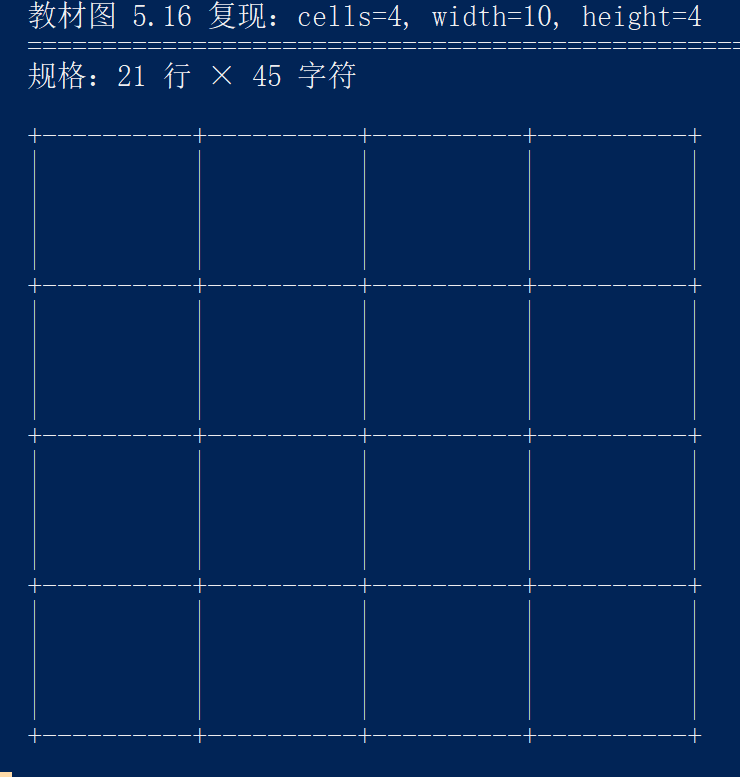
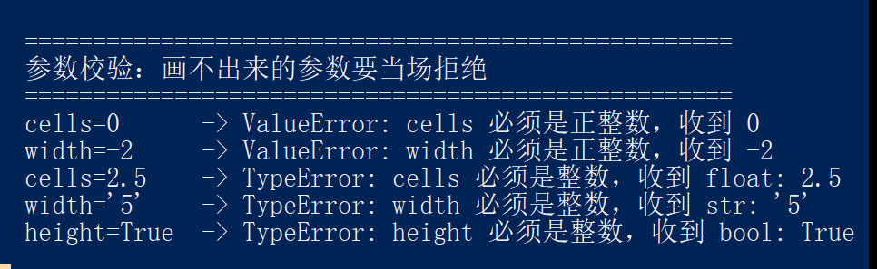
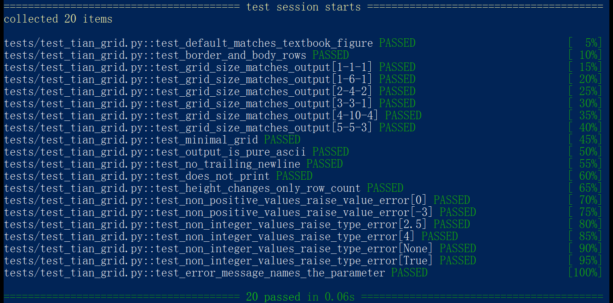
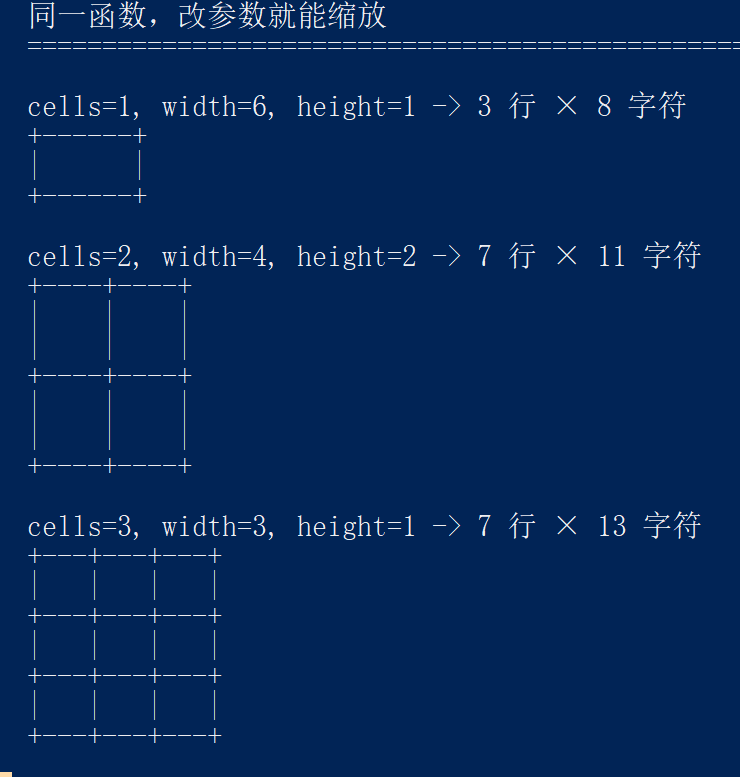
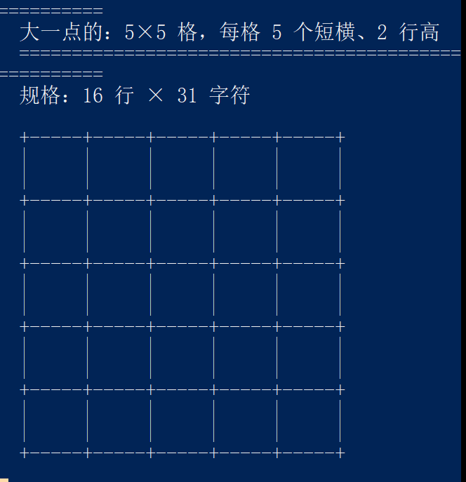
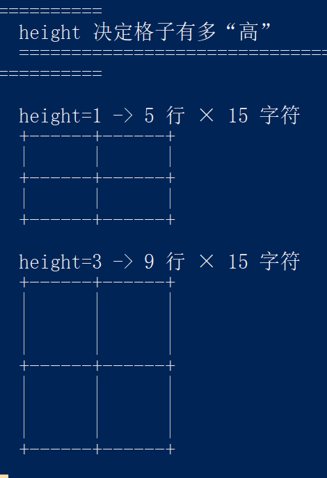

# 字符田字格绘制：把一条 print 拆成一个能任意缩放的函数

> 作业来源：教材 P196 程序练习题 5.1。
> 要求：用字符方式打印输出一个简单的田字格，效果如图 5.16；要求采用函数方式，以田字格宽度为参数，能够根据参数绘制任意大小的田字格。
> 结果：一个 `draw_tian(cells, width, height)` 纯函数，20 条 pytest 用例全绿，文中的截图都来自本机真实运行。

仓库：<https://github.com/Hanna2126/homework>



## 1. 先把题目量成数字

课本上的要求只有三句话，但“如图 5.16 所示”才是真正的验收标准。把图放大、逐格数一遍，可以得到三个数字：

- 每边 **4 个格子**，也就是 4×4；
- 每个格子横向 **10 个短横**；
- 每个格子纵向 **4 行**（不含上下两条边框）。

由这三个数字可以直接算出整块图形的大小：每行 `1 + 4 × (10 + 1) = 45` 个字符，一共 `4 × (4 + 1) + 1 = 21` 行。程序跑出来的第一行输出就是“规格：21 行 × 45 字符”，和数出来的结果一致。

这一步很重要。如果只按题目字面理解“以田字格宽度为参数”，很容易写成一个只控制横向的函数，画出来的格子全是扁的，和图 5.16 对不上。**参数不是从题目文字里抄的，是从样例图里量出来的。**

## 2. 拆图：整块田字格只有两种行

把图按行切开，会发现它只有两种行在交替出现：

- **边框行**：一个 `+`，接 `width` 个 `-`，再接一个 `+`，重复 `cells` 次；
- **格身行**：一个 `|`，接 `width` 个空格，再接一个 `|`，同样重复 `cells` 次。

两种行交替排列，开头和结尾都是边框行，所以总行数是 `cells × (height + 1) + 1`，每行字符数是 `1 + cells × (width + 1)`。

这里有一个容易忽略的点：`height` 不是多余的参数。教材 3.5 的简化版是“一格一行”，那只是 `height = 1` 的特例，总行数退化成 `2n + 1`；图 5.16 的格子明显是高高的 4 行，所以总行数是 `5n + 1`。**只参数化宽度，最多只能画出“扁平田字格”。**


## 3. 从逐格打印到纯函数

### 3.1 第一版：逐格打印，接缝处冒出两个加号

最直觉的写法是两层循环，一个格子一个格子地拼：

```python
# 错误示范：每个格子单独收尾，边框会被切成好几段
for r in range(cells):
    for c in range(cells):
        print("+" + "-" * width + "+", end="")
    print()
```

这样写有两个问题：一是每格都自带左右两个 `+`，相邻两格拼在一起就出现 `++`；二是行尾的 `+` 多打一次，整行长度会多出 1 个字符，格子宽度也跟着乱。**字符画的接缝问题，本质是“谁负责打哪一段”没定义清楚。**

### 3.2 第二版：先拼整行，再一次性打印

正确做法是先把一整行拼成一个字符串，再交给 `print`：

```python
border = "+" + ("-" * width + "+") * cells   # +----------+----------+...
body   = "|" + (" " * width + "|") * cells   # |          |          |...
```

`"-" * width + "+"` 是“一个格子的右半段”，再整体乘 `cells`，最后补上最左边的 `+`。这样每一行的字符数是严格算出来的，不会多也不会少。

### 3.3 最终版：返回字符串的纯函数

最后一版不直接打印，而是**返回字符串**。打印交给调用方，函数只负责“按参数生成图形”：

```python
def draw_tian(cells=4, width=10, height=4) -> str:
    _check_int("cells", cells)
    _check_int("width", width)
    _check_int("height", height)

    border = "+" + ("-" * width + "+") * cells
    body = "|" + (" " * width + "|") * cells

    lines = [border]
    for _ in range(cells):
        lines.extend([body] * height)
        lines.append(border)
    return "\n".join(lines)
```

好处很实际：

- **可测试**：pytest 可以直接断言行数、每行长度、边框行的位置，不用去抓 `print` 的输出；
- **可组合**：要写文件、要放进网页的 `<pre>`、要一次打印好几张图，都只是对字符串做事；
- **无副作用**：调用一次不会偷偷往终端写东西，测试里用 `capsys` 验证过。

## 4. 参数校验：画不出来的参数要当场拒绝

`cells = 0` 时会输出一行 `+`，看起来“程序没崩”，其实一个格子都没有；`width = -2` 会得到空字符串；`cells = 2.5` 会在 `range()` 里直接炸掉，报错信息还跟田字格无关。与其让错误在深处出现，不如在函数入口就拦下来：

- 不是 `int` → `TypeError`，信息里带上类型和值；
- 不是正整数 → `ValueError`，信息里带上参数名和当前值。

这里有个 Python 的坑：`bool` 是 `int` 的子类，`True` 会被当成 1 混过去。所以校验要写成 `isinstance(value, bool) or not isinstance(value, int)`，先把布尔值单独排除。



## 5. 测试：20 条用例分别在测什么

测试没有只写“跑一遍不报错”，而是按四个维度拆开：

| 维度 | 用例 | 断言的内容 |
| --- | --- | --- |
| 形状 | `test_default_matches_textbook_figure` | 默认参数输出 21 行 × 45 字符 |
| 形状 | `test_grid_size_matches_output`（6 组参数） | `grid_size()` 算出的行数、列数与真实输出一致 |
| 结构 | `test_border_and_body_rows` | 边框行出现在第 0、5、10、15、20 行，`+` 与 `|` 各 5 个 |
| 结构 | `test_height_changes_only_row_count` | 只改 `height`，列数不变、行数按 `cells × Δheight` 增加 |
| 字符 | `test_output_is_pure_ascii` | 全是 ASCII，没有制表符、没有全角空格 |
| 契约 | `test_does_not_print` | 函数不打印，只返回字符串 |
| 边界 | `test_minimal_grid` | 1×1×1 输出 `+-+ / | | / +-+` |
| 异常 | 非正整数、非整数、错误信息带参数名 | `ValueError` / `TypeError` |

写测试时还真抓到一个错误：`cells=2, width=3` 那一组，我最初把每行字符数写成了 8，实际是 `1 + 2 × 4 = 9`，pytest 直接红了一条。**公式背下来没用，得让程序替你算。**



## 6. 踩坑记录

1. **全角空格**。用中文输入法时很容易在格身行里打出全角空格 `　`，它的显示宽度是普通空格的两倍，肉眼看不出，复制到等宽字体里整行就歪了。所以有一条测试专门断言输出全是 ASCII。
2. **长横线 `—` 和短横 `-` 不是一回事**。网上有些答案是 `"—— " * 4`，em dash 的宽度和 `-` 完全不同，在等宽字体里会断成虚线；教材图用的是短横。
3. **逐格打印的 `++`**。见 3.1，本质是没有先定义“哪一段由谁负责”。
4. **控制台字体必须等宽**。Windows Terminal 默认 Cascadia Mono/Consolas 没问题，但粘贴到 Word、浏览器里如果字体不等宽，图形就会歪；博客里统一用代码块就是这个原因。
5. **`height` 不是想加就加**。题目只说“宽度”，但图 5.16 的格子是 4 行高。参数是照着验收标准长的，不是照着题目字面长的。

## 7. 尺寸与复杂度

同一套函数，改参数就能得到不同规格：

| cells | width | height | 每行字符数 | 总行数 | 效果 |
| --- | --- | --- | --- | --- | --- |
| 1 | 6 | 1 | 8 | 3 | 一个扁格 |
| 2 | 4 | 2 | 11 | 7 | 最常见的 2×2 田字格 |
| 3 | 3 | 1 | 13 | 7 | 3×3，一行一格 |
| 4 | 10 | 4 | 45 | 21 | 教材图 5.16 |
| 5 | 5 | 2 | 31 | 16 | 5×5 大图 |







复杂度方面：输出字符总数是 `(n(h+1)+1) × (n(w+1)+1)`，量级是 `O(n²hw)`；每拼一行是 `O(n(w+1))`；因为整块图形作为一个字符串返回，额外空间是 `O(总字符数)`。如果要打印超大尺寸，可以改成逐行 `yield` 的生成器，内存就只跟一行有关。

还可以往下延伸：把结果写进 `.txt`、做成“练字纸”批量导出；或者做米字格——那需要在每行按位置插入 `\` 和 `/`，属于字符网格之外的新问题，正好留作下一道练习。

## 8. 复现

```bash
git clone https://github.com/Hanna2126/homework.git
cd homework/01-字符田字格绘制

python demo.py textbook   # 教材图 5.16
python demo.py sizes      # 1×1、2×2、3×3
python demo.py big        # 5×5
python demo.py heights    # 格高对比
python demo.py errors     # 参数校验

python -m pytest -v       # 20 条用例
```

这次作业最大的收获不是“会画田字格”，而是把“函数化”这三个字拆开看了：**先找出图形的规律，再用公式固定尺寸，最后才决定参数和返回值。** 参数不是越多越好，而是每一个都能从验收标准里找到依据。
