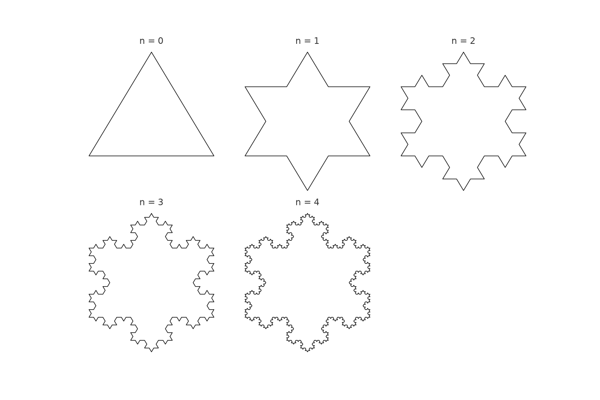
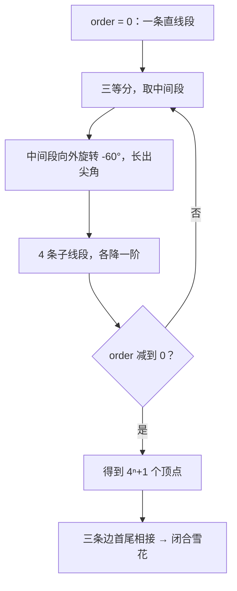
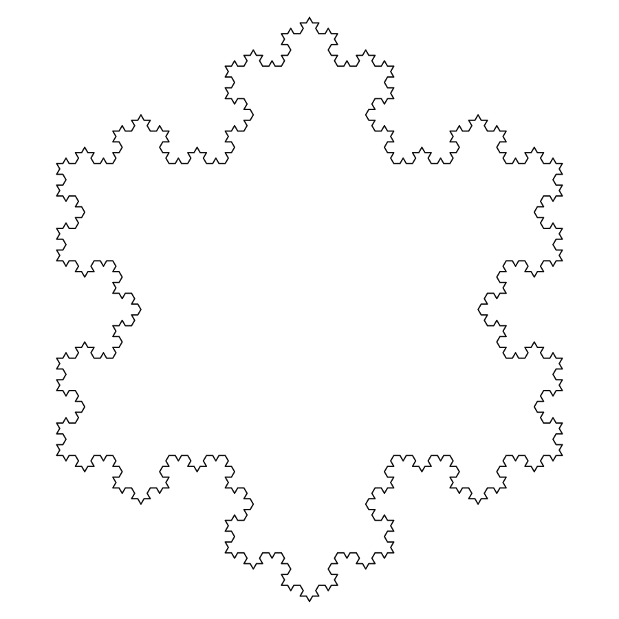
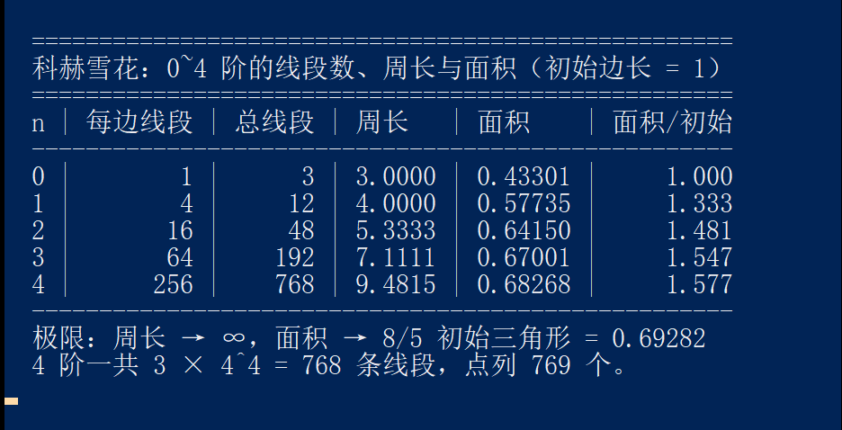
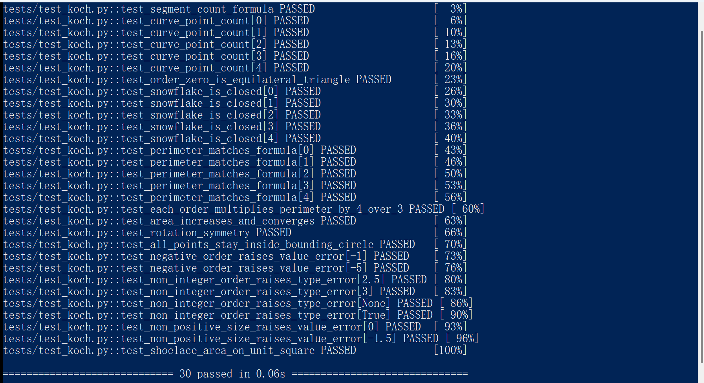

# 科赫雪花：一条线段递归成 4ⁿ，用复数算到 4 阶

> 作业来源：教材第 5 章「函数与递归」的科赫雪花题。
> 要求：绘制科赫雪花，根据阶数生成（0~4 阶）。
> 结果：`snowflake(order, size)` 返回一条闭合折线；0~4 阶分别是 3 / 12 / 48 / 192 / 768 条线段，30 条 pytest 用例全绿，文中截图都来自本机真实运行。

仓库：<https://github.com/Hanna2126/homework>



## 1. 先把题目拆成两件事

这道题看起来是“画图”，实际上是两个独立的问题：

1. **几何**：给定阶数 `n`，雪花的顶点坐标是什么？
2. **呈现**：拿到顶点之后，用 turtle 画、用 matplotlib 画，还是输出成别的格式？

把两者混在一起写，代码会变成“一边递归一边调画笔”，既不好测试，也换不了渲染方式。所以这次从一开始就分开：

- `src/koch.py` 只算坐标，不 import turtle、不 import matplotlib；
- `src/render.py` 只负责把坐标画成 PNG；
- `src/draw_turtle.py` 保留教材里的 turtle 画法，作为另一种“呈现”。

分开之后，几何部分可以在没有图形界面的环境里跑测试，这一点在后面救了我一次。

## 2. 递归规则：每条线段换成 4 条

科赫曲线的生成规则只有一句话：**把每条线段三等分，中间那段向外折成一个等边三角形的两条边。**

一条长度 `L` 的线段，替换后变成 4 条长度 `L/3` 的线段。于是：

- 线段数：`N(n) = 4 × N(n-1)`，初始是 3 条边，所以 `N(n) = 3 × 4ⁿ`；
- 单段长度：`L(n) = L / 3ⁿ`；
- 周长：`3 × L(n) × 4ⁿ = 3L × (4/3)ⁿ`。

0~4 阶对应的线段数是 3、12、48、192、768。4 阶一共 768 段、769 个顶点。



## 3. 用复数表示平面点，60° 就是一个乘法

如果按课本的写法，每个顶点都要手算 `(x, y)`，递归里全是 `sin`、`cos`。这次换一种表示：**平面上的点直接用复数 `x + yj`**。

这样有两个好处：

- 旋转 60° 不用写三角函数，乘一个单位复数就行：`exp(1j * π/3)`；
- 平移就是加法，缩放就是乘以实数，代码里没有一堆 `x1, y1, x2, y2`。

### 3.1 尖角到底往哪边折

这是本次唯一一个“想反了就会画出内凹图形”的地方。

设线段从 `A` 到 `B`。雪花的三条边是**逆时针**排列的，所以多边形的内部在线段前进方向的**左侧**，外部在右侧。尖角要长到外面，就得向**右**偏 60°，也就是旋转 `-60°`：

```python
OUTWARD = exp(-1j * pi / 3)   # 顺时针 60°，指向边外
```

如果写成 `+60°`，尖角会全部折进三角形内部，画出来是一个“毛茸茸的三角形”，不是雪花。这个错误在纸上不明显，在屏幕上非常明显。

### 3.2 递归函数

```python
def koch_curve(order, start, end):
    if order == 0:
        return [start, end]

    third = (end - start) / 3
    p1 = start + third
    p2 = p1 + third * OUTWARD
    p3 = start + 2 * third

    return (
        koch_curve(order - 1, start, p1)[:-1]
        + koch_curve(order - 1, p1, p2)[:-1]
        + koch_curve(order - 1, p2, p3)[:-1]
        + koch_curve(order - 1, p3, end)
    )
```

`p1`、`p3` 是两个三等分点；`p2` 是中间段绕 `p1` 旋转 `-60°` 得到的尖角。四段子曲线拼起来时，前三段都用了 `[:-1]`，因为每段的终点就是下一段的起点，不去重的话点列里会出现重复点，画线时虽然看不出来，但“顶点数 = 4ⁿ + 1”这条断言就会失败。

### 3.3 雪花 = 三条边 + 闭合

```python
def snowflake(order, size=1.0, center=0j):
    radius = size / sqrt(3)
    vertices = [center + radius * exp(1j * (pi / 2 + 2 * pi * k / 3)) for k in range(3)]

    points = []
    for k in range(3):
        segment = koch_curve(order, vertices[k], vertices[(k + 1) % 3])
        points.extend(segment[:-1])
    points.append(points[0])
    return points
```

三个顶点放在 90°、210°、330°，逆时针排列，这样上方是尖的、图形正着放。`radius = size / √3` 是边长为 `size` 的等边三角形的外接圆半径。最后把首点再补一次，得到闭合折线——这样 `polygon_area` 可以直接按闭合多边形算面积。



## 4. 三个数字：线段数、周长、面积

几何跑通之后，剩下的是用公式和代码互相验证。

### 4.1 线段数与周长

```python
def segment_count(order):
    return 3 * 4 ** order

def perimeter(order, size=1.0):
    return 3 * size * (4 / 3) ** order
```

两条公式都能从递归直接推出来：每次替换，段数乘 4、单段长度除以 3，所以周长乘 `4/3`。这个“乘 4/3”也是科赫曲线最反直觉的地方——**它围住的面积有限，边界长度却趋于无穷**。

### 4.2 面积

面积用鞋带公式（Shoelace formula）算。对闭合多边形 `p₀, p₁, …, pₙ = p₀`：

\[
A = \frac{1}{2}\left|\sum_{i=0}^{n-1}\left(x_i y_{i+1} - x_{i+1} y_i\right)\right|
\]

用复数写，叉积项正好是 `imag(conj(a) * b)`：

```python
def polygon_area(points):
    total = 0j
    for a, b in zip(points, points[1:]):
        total += a.conjugate() * b
    return abs(total.imag) / 2
```

### 4.3 面积为什么会收敛到 8/5

第 `k` 阶新长出来的小三角形有 `3 × 4^{k-1}` 个，每个面积是初始三角形的 `1/9ᵏ`。所以：

\[
A_n = \frac{\sqrt{3}}{4}\left[1 + \frac{3}{4}\sum_{k=1}^{n}\left(\frac{4}{9}\right)^k\right]
\]

等比级数公比 `4/9 < 1`，取极限：

\[
A_\infty = \frac{\sqrt{3}}{4}\left[1 + \frac{3}{4}\cdot\frac{4/9}{1-4/9}\right] = \frac{\sqrt{3}}{4}\cdot\frac{8}{5} = \frac{2\sqrt{3}}{5} \approx 0.69282
\]

程序跑出来的 0~4 阶面积是 0.43301、0.57735、0.64150、0.67001、0.68268，单调递增，和 0.69282 的差越来越小：



控制台里那张表就是 `python demo.py metrics` 的输出：`n`、每边线段、总线段、周长、面积、面积/初始三角形。

## 5. 两种画法：turtle 和 matplotlib

### 5.1 turtle 版：教材里的画法

```python
def koch(order, size):
    if order == 0:
        turtle.forward(size)
        return
    koch(order - 1, size / 3)
    turtle.left(60)
    koch(order - 1, size / 3)
    turtle.right(120)
    koch(order - 1, size / 3)
    turtle.left(60)
    koch(order - 1, size / 3)
```

递归结构和 `koch_curve` 完全一样，只是“算出顶点”换成了“让海龟走”。起点在顶部顶点 `(0, size/√3)`，初始航向 `-60°`，每画完一条边右转 120°。

### 5.2 为什么仓库里的图不是 turtle 窗口

这台机器的 Python 装了 tkinter，但缺 Tcl 的运行数据，`tk.Tk()` 直接报：

```text
_tkinter.TclError: Can't find a usable init.tcl
```

换句话说是“有 Python 的壳，没有 Tcl 的芯”，turtle 窗口开不出来。所以 `截图/01~06` 是用 matplotlib 的 Agg 后端渲染的：

```python
def render_order(order, path, pixels=900):
    fig = plt.figure(figsize=(6, 6), dpi=pixels // 6)
    ax = fig.add_axes([0, 0, 1, 1])
    _plot(ax, order)
    ax.axis("off")
    fig.savefig(path, facecolor="white")
    plt.close(fig)
```

关键点是：**`_plot` 里的点来自 `snowflake(order)`，和 turtle 版用的是同一套坐标、同一个朝向**，所以图形形状与 turtle 画出来的一致，只是没有那个窗口。`draw_turtle.py` 仍然留在仓库里，换一台 tkinter 完整的机器就能直接跑。

这不是“假装截了 turtle 的图”，而是把几何和呈现拆开之后，换一个渲染后端继续验证同一个结果。

## 6. 测试：30 条用例

`tests/test_koch.py` 覆盖了四类东西：

- **结构**：线段数 `3×4ⁿ`、曲线点数 `4ⁿ+1`、0 阶就是等边三角形、首尾点重合；
- **数值**：周长公式与“逐阶乘 4/3”、面积单调递增、缺口按 `4/9` 收敛；
- **对称**：转 120° 后点集不变（三条边完全等价）、所有点落在包围圆内；
- **校验**：负阶数 `ValueError`、`2.5` / `"3"` / `None` / `True` 一律 `TypeError`、非正边长 `ValueError`。

其中面积收敛没有写死一个宽松的阈值，而是断言“缺口比值”：

```python
gaps = [LIMIT_AREA - a for a in areas]
ratios = [b / a for a, b in zip(gaps, gaps[1:])]
assert all(math.isclose(r, 4 / 9, rel_tol=1e-6) for r in ratios)
```

这比“和极限差小于某个数”更能说明公式是对的——它验证的是收敛的**速度**，而不只是“看起来接近”。



## 7. 踩过的三个坑

### 7.1 鞋带公式多算了一倍

第一版写的是：

```python
total += a.conjugate() * b - a * b.conjugate()
```

跑出来 0 阶三角形面积是 0.86603，正好是正确值 0.43301 的两倍。原因很直接：`conj(a)b - a conj(b)` 等于 `2j · imag(conj(a)b)`，本身已经带了因子 2，再除以 2 就抵消了。改成只累加 `conj(a) * b`，再取 `imag / 2`，面积立刻对上 `√3/4`。

这也说明测试里那条“0 阶面积等于 `√3/4`”不是凑数——它专门抓这类公式系数错误。

### 7.2 尖角方向反了

前面说过，`OUTWARD` 必须是 `exp(-1j * π/3)`。判断依据不是“书上画在哪”，而是“多边形内部在前进方向的左侧”。换任何起点、任何顺序，这条规则都成立。

### 7.3 控制台截图的窗口尺寸与字体

`mode con cols=… lines=…` 只改**缓冲区**大小，不改窗口高度；字体则要临时改 `HKCU\Console` 的 `FaceName` / `FontSize`，再启动新的控制台进程。截图用 `PrintWindow(hwnd, hdc, 2)`，不能只用 `CopyFromScreen`——否则窗口被别的程序挡住时，截到的是遮挡物。

## 8. 复杂度与规模

- 时间：`O(4ⁿ)`，因为顶点数就是 `4ⁿ + 1`；4 阶 769 个点，毫秒级；
- 空间：同样 `O(4ⁿ)`，递归深度只有 `n`；
- 渲染：单图 900×900，对比图 3×2 面板 1560×1040；
- 真正限制阶数的是**线段数量**而不是递归深度：再往上加一阶，段数乘以 4，画线和文件都会迅速变大。

## 9. 怎么复现

```bash
git clone https://github.com/Hanna2126/homework.git
cd homework/02-科赫雪花

python demo.py metrics      # 打印 0~4 阶指标表
python demo.py render       # 生成 6 张 PNG 到 截图/
python -m pytest -q         # 30 passed
python src/draw_turtle.py 4 # 有 tkinter 的机器上开窗口画 4 阶
```

如果只想看图形，`截图/06-阶数对比.png` 是最直观的一张：0 阶三角形、1 阶六角星、2 阶开始出现细密锯齿，4 阶已经很像一片雪花。

## 10. 小结

这道题真正值得记的不是“科赫雪花怎么画”，而是三个可以迁移的习惯：

1. **几何与呈现分离**：坐标算对了，换渲染后端只是换一个函数；
2. **用不变量写测试**：线段数、闭合性、对称性、收敛速度，比“截图看起来像”可靠；
3. **公式和代码互相校验**：周长 `(4/3)ⁿ`、面积 `2√3/5`，都能先用纸笔推出来，再让程序去撞。
