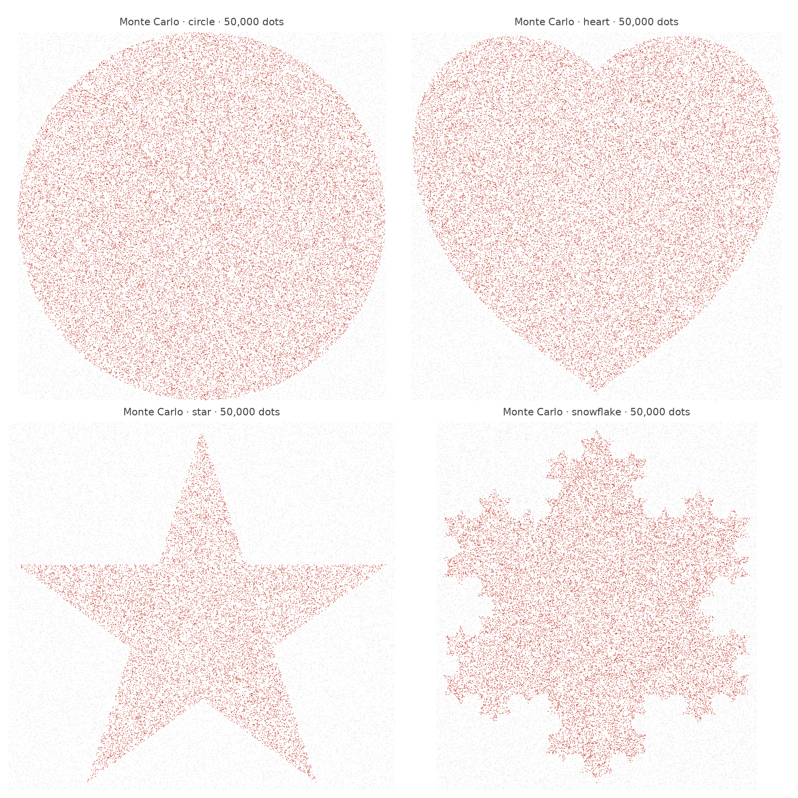
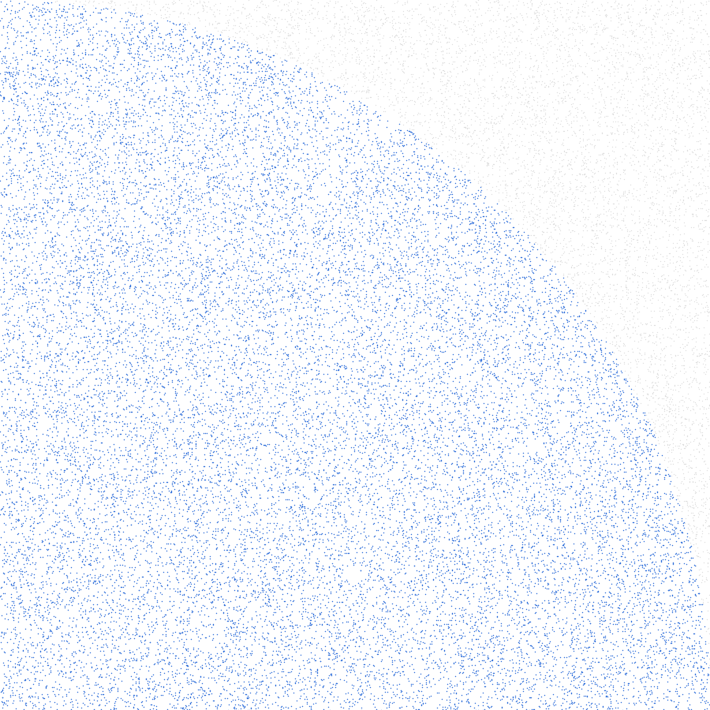
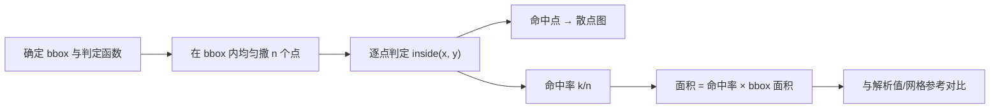
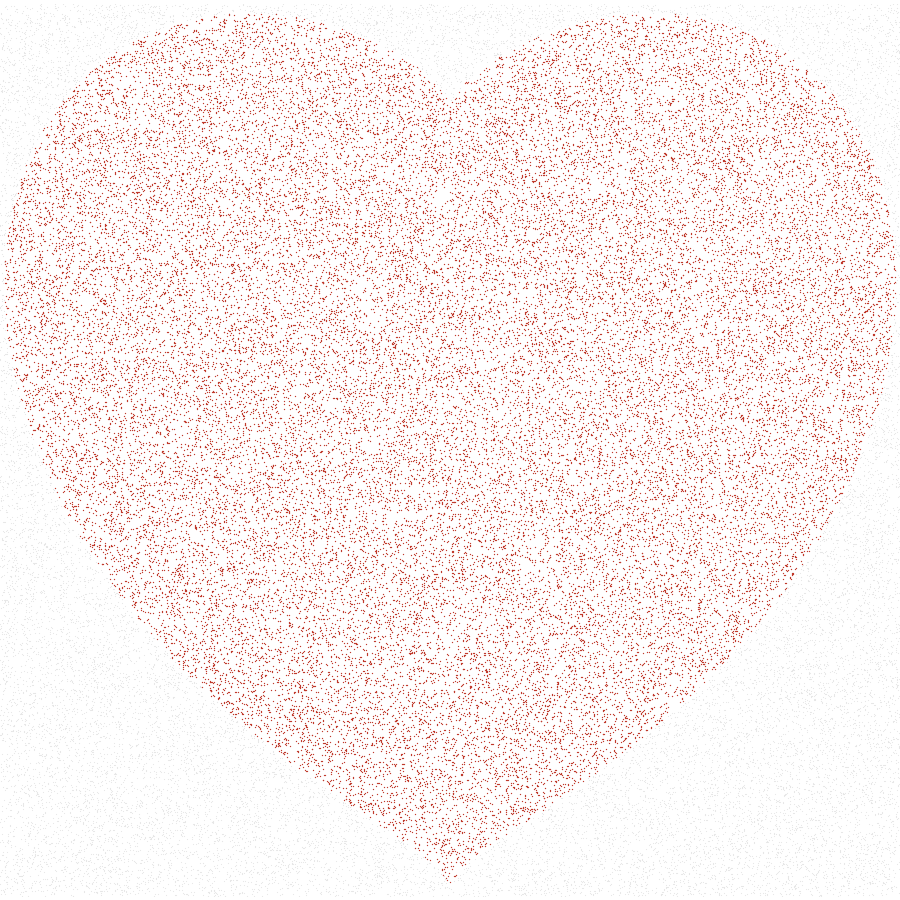
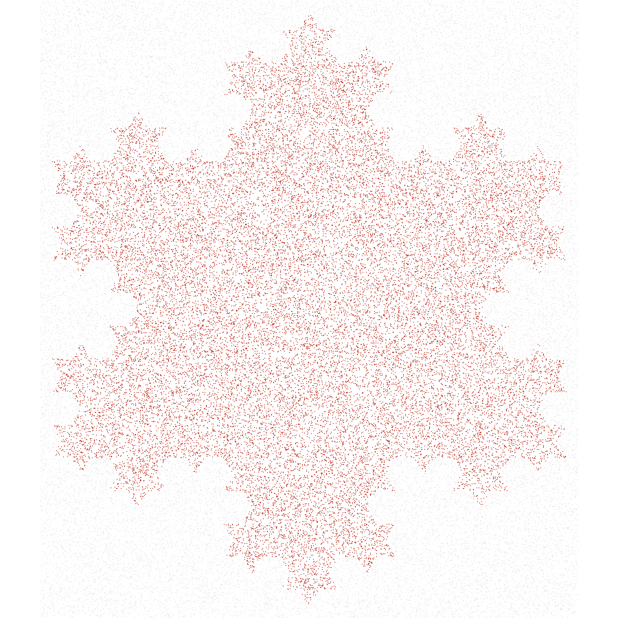
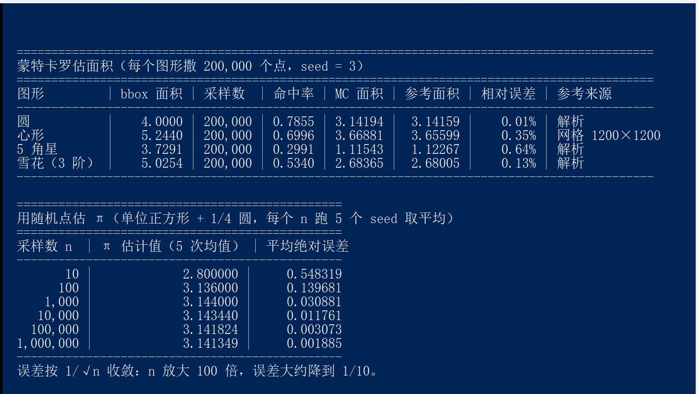
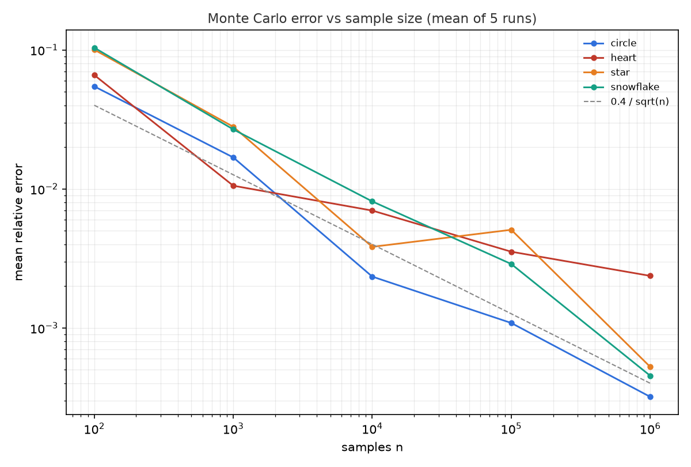
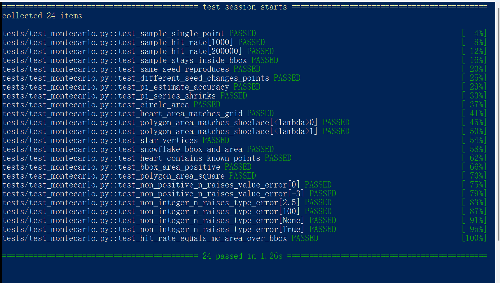

# 蒙特卡罗手搓图形：不画一笔，用随机点堆出四个形状

> 作业来源：课堂 PPT「homework · 蒙特卡罗方法手搓图形」。
> 结果：四个图形（圆、心形、五角星、科赫雪花）各撒 20 万点，面积相对误差 ≤ 0.64%；π 的误差按 1/√n 收敛；24 条 pytest 全绿，截图均来自本机真实运行。

仓库：<https://github.com/Hanna2126/homework>



## 1. “手搓”在这里是什么意思

题目只有一句话，我把它理解成两层：

1. **图形本身要“手搓”**：不用 `circle()`、`plot()` 这种图元描边，只允许随机点；
2. **方法要用蒙特卡罗**：靠大量随机样本的命中比例去逼近面积、π 这类确定量。

于是整个作业只有一个核心动作：**在一个矩形框里均匀撒点，判断每个点在不在图形里**。留下来的点就是图形，命中率乘矩形面积就是面积。

这样做的好处是：同一套采样代码，换一个判定函数就换一个图形；图形不再是“画”出来的，而是“筛”出来的。

## 2. 为什么随机点能堆出形状

设矩形框面积为 \(A_{\text{box}}\)，图形面积为 \(A\)。均匀撒点后，点落在图形内的概率是：

$$
p = \frac{A}{A_{\text{box}}}
$$

撒 \(n\) 个点，命中 \(k\) 个，用频率代替概率：

$$
\hat{A} = \frac{k}{n} \cdot A_{\text{box}}, \qquad \hat{p} = \frac{k}{n}
$$

由大数定律，\(n \to \infty\) 时 \(\hat p \to p\)。这就是“点画”能显形的原理：点足够多时，边界处的密度差肉眼可见。



上图是单位正方形里撒 3 万个点，蓝色是落在 1/4 圆内的点。圆弧不是画出来的，是“命中/不命中”的分界线自然形成的。



## 3. 误差：为什么是 1/√n

每次采样是伯努利试验，命中率的标准差是：

$$
\sigma_{\hat p} = \sqrt{\frac{p(1-p)}{n}}
$$

所以面积的相对误差大约按 \(1/\sqrt{n}\) 下降：**样本放大 100 倍，误差只降到 1/10**。这是蒙特卡罗最需要记住的一条——它收敛得慢，但慢得很有规律。

还有两个容易被忽略的点：

- \(p\) 越接近 0 或 1，方差 \(p(1-p)\) 越小，估计越稳；五角星的命中率只有 0.299，所以它的误差比圆大。
- bbox 越“松”，\(p\) 越小，同样的 \(n\) 下有效样本越少。心形的 bbox 面积 5.244，而图形面积只有 3.66，命中率 0.70，相当于白白丢了 30% 的样本。

## 4. 四个图形怎么定义

### 4.1 圆：判定就是一个不等式

```python
def circle(radius=1.0):
    def contains(x, y):
        return x * x + y * y <= radius * radius
    return Shape("圆", (-r, r, -r, r), contains, pi * r * r)
```

参考面积 \(\pi r^2\)，命中率理论值 \(\pi/4 \approx 0.7854\)，实测 0.7855。

### 4.2 心形：一条隐函数曲线

经典心形 \((x^2+y^2-1)^3 - x^2 y^3 = 0\)，内部就是让左边小于等于 0：

```python
def contains(x, y):
    return (x * x + y * y - 1) ** 3 - x * x * y ** 3 <= 0
```

它没有简单的初等面积公式，所以参考值用 1200×1200 的网格积分（`grid_area`）算，表里标成“网格”。



### 4.3 五角星、雪花：多边形 + 鞋带公式

这两个是闭合多边形，面积可以用鞋带公式精确算：

```python
def polygon_area(vertices):
    total = 0.0
    for (x1, y1), (x2, y2) in zip(vertices, vertices[1:] + vertices[:1]):
        total += x1 * y2 - x2 * y1
    return abs(total) / 2
```

判定用 `matplotlib.path.Path.contains_points`——它只做几何包含判断，不参与绘图，所以“手搓图形”的约定没有被破坏。

雪花直接复用了作业 02 的科赫递归，取 3 阶、边长 2，面积 2.68005。



## 5. 代码骨架：一个 dataclass 管四个图形

```python
@dataclass(frozen=True)
class Shape:
    name: str
    bbox: tuple[float, float, float, float]
    contains: Callable[[np.ndarray, np.ndarray], np.ndarray]
    ref_area: float | None = None

    @property
    def bbox_area(self):
        xmin, xmax, ymin, ymax = self.bbox
        return (xmax - xmin) * (ymax - ymin)
```

采样只有一个函数：

```python
def sample(shape, n, seed=None):
    xmin, xmax, ymin, ymax = shape.bbox
    rng = np.random.default_rng(seed)
    x = rng.uniform(xmin, xmax, n)
    y = rng.uniform(ymin, ymax, n)
    return x, y, shape.contains(x, y)
```

`estimate_area` 只是在它外面乘一个 `bbox_area * inside.mean()`。换图形 = 换 `Shape`，采样和估计完全不动。

## 6. 渲染：真的只有点

```python
ax.scatter(x[~inside], y[~inside], s=0.3, c="#e6e6e6", linewidths=0)
ax.scatter(x[inside], y[inside], s=0.4, c="#c0392b", linewidths=0)
```

- 命中点用红色，未命中点用极浅的灰色（用来交代 bbox 的范围）；
- `s` 取 0.3~0.5，单个点几乎不可见，几万个点叠起来才有“面”的感觉；
- `rasterized=True`，避免几万个散点把 SVG/PDF 撑爆；
- 等比例坐标轴，否则圆会被拉成椭圆。

## 7. 结果

20 万点的面积表（`python demo.py metrics`）：



四个图形的相对误差：圆 0.01%、心形 0.35%、五角星 0.64%、雪花 0.13%。五角星误差最大，正好对应它最低的命中率（0.299）——方差大。

π 的收敛表把每个 \(n\) 跑 5 个 seed 取平均，误差从 0.55 降到 0.0019，基本每 100 倍样本降一个数量级。



图里的虚线是 \(0.4/\sqrt{n}\)。四条曲线大体贴着它走，但心形在 \(10^5\) 之后压不下去——不是采样不够，而是它的“参考面积”本身是 1200×1200 网格算的，网格误差约 0.2%，形成了误差地板。**用近似值当基准，就永远测不出比它更小的误差。**

## 8. 测试：24 条

- **采样**：返回长度、`bool` 类型、单点采样、命中率区间、点不越出 bbox；
- **可复现**：同 seed 完全一致，不同 seed 必然不同；
- **数值**：π 在 1e6 时误差 < 0.01；π 的误差随 n 单调下降；圆面积误差 < 1%；心形与网格参考差 < 2%；星/雪花与鞋带值差 < 2%；
- **几何**：心形内点/外点、五角星面积、雪花面积公式、单位正方形鞋带面积；
- **参数**：`n = 0 / -3` → `ValueError`；`2.5 / "100" / None / True` → `TypeError`；
- **一致性**：`bbox_area * 命中率` 与 `estimate_area` 完全相等。



## 9. 踩过的坑

### 9.1 单点采样不能断言命中率

最初把 `n=1` 也放进“命中率 0.70~0.86”的参数化用例里，结果当然失败——一个点要么命中要么不命中。命中率是统计量，样本太小时不成立。后来把 `n=1` 单独拆成“形状正确”的用例。

### 9.2 雪花面积错用了极限值

第一版以为“雪花面积 = 8/5 初始三角形”，直接拿 \(8\sqrt{3}/5 \approx 2.771\) 当参考，结果 3 阶实测 2.68005，差了 3.4%。8/5 是 \(n \to \infty\) 的极限，有限阶要用：

$$
A_n = \frac{\sqrt{3}}{4}s^2\left[1 + \frac{3}{4}\sum_{k=1}^{n}\left(\frac{4}{9}\right)^k\right]
$$

### 9.3 同一个 seed 跑不同 n，表格出现两行相同

π 表最初每行都用 `seed=9`，而小 n 的样本是大 n 的前缀，于是 1000 和 10000 两行估出了同一个值。改成“每个 n 跑 5 个 seed 取平均”，既避免前缀复用，也让误差列单调。

### 9.4 bbox 太松，方差白白变大

心形 bbox 5.244、实际面积 3.656，命中率只有 0.70；如果把 bbox 收紧到曲线真实外接矩形，同样的 20 万点能把误差再压低一截。**蒙特卡罗的精度不只取决于 n，还取决于“框得紧不紧”。**

### 9.5 控制台截图顶部被卷走

窗口高度小于输出行数时，控制台会自动滚到底部，截图顶部就少几行。解决办法是把窗口高度设到能容纳全部输出（`-WinHeight`），而不是只改缓冲区行数（`mode con lines=` 只改 buffer，不改窗口）。

## 10. 复杂度

- 时间：\(O(n)\)，每个点做一次判定；1e6 个点约几十毫秒（numpy 向量化）；
- 空间：\(O(n)\)，但可以分块采样把内存压到常数；
- 渲染：6 万点/图，`rasterized=True`，PNG 几百 KB；
- 精度：相对误差 \(O(1/\sqrt{n})\)，想多一位小数，样本要乘 100。

## 11. 复现

```bash
git clone https://github.com/Hanna2126/homework.git
cd homework/03-蒙特卡罗手搓图形

python demo.py metrics
python demo.py render
python -m pytest -q
```

改图形只需要在 `src/shapes.py` 里加一个 `Shape`：给 bbox、给 `contains`、给参考面积（没有解析式就留 `None`）。

## 12. 小结

1. **随机不等于不准**：误差有明确的 \(1/\sqrt{n}\) 规律，可以预估、可以验证；
2. **参考值决定误差地板**：拿网格近似当基准，就测不出更小的误差，博客里要如实标注来源；
3. **“手搓”是一种约束**：不给描边、不给图元，反而逼着把“形状 = 判定函数”这件事想清楚。
