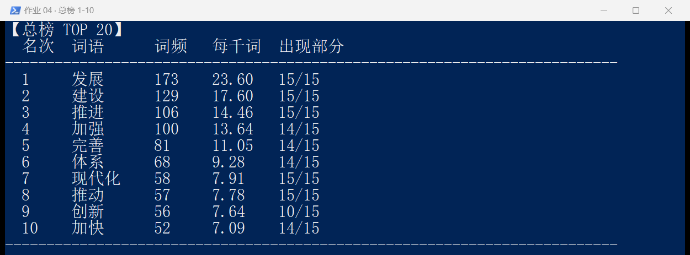
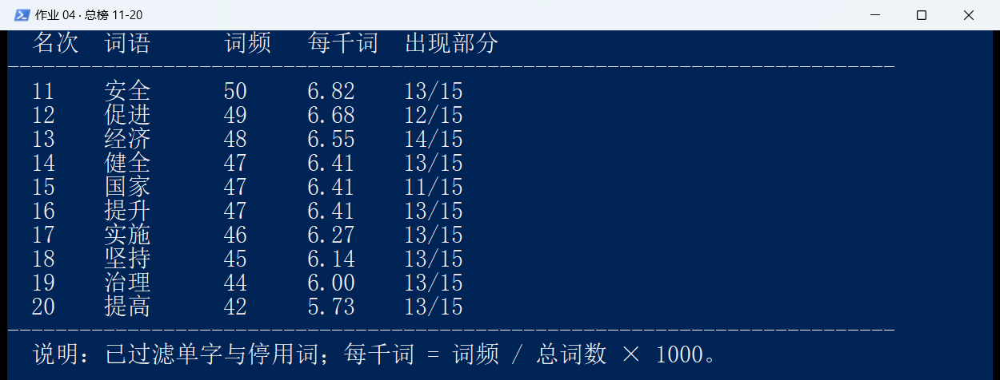
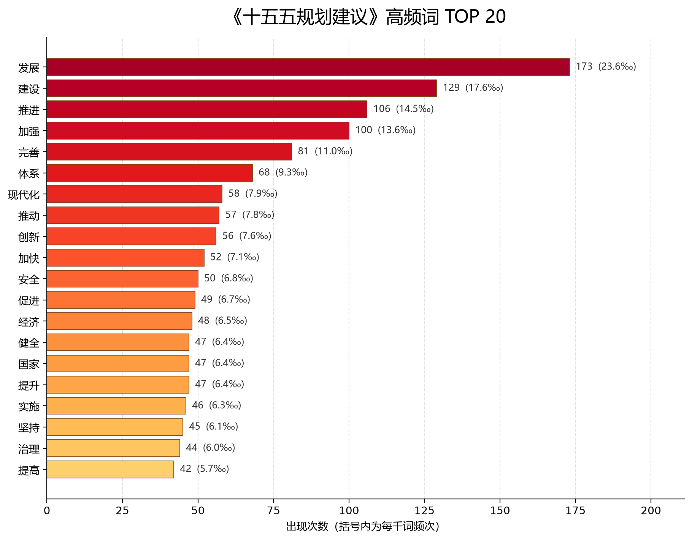
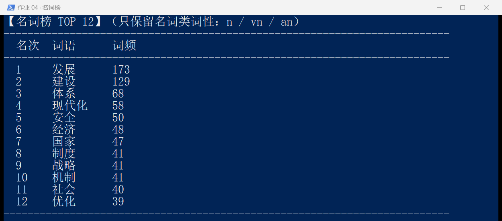
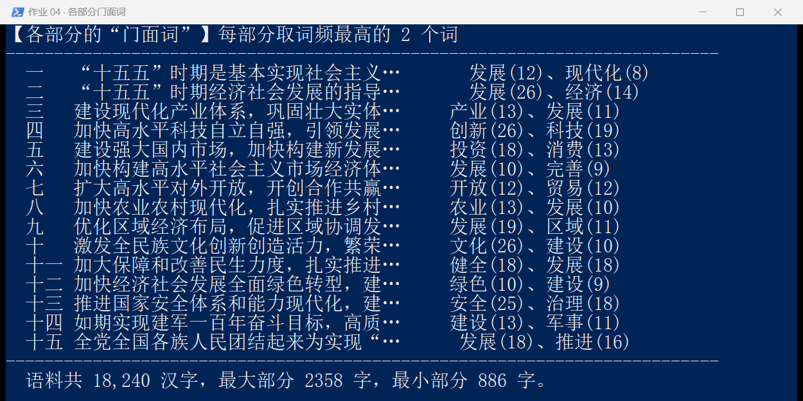
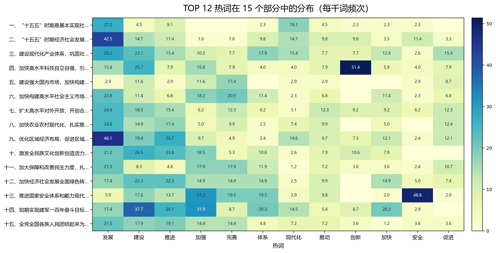
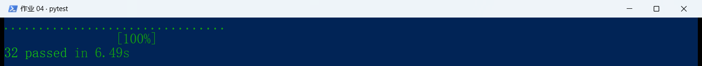

# 把 2 万字报告读成 20 个词：《十五五规划建议》热词统计

> 作业来源：课堂 PPT「homework to blog · 编写程序，统计十五五发展规划报告热词频率」。
> 结果：全文 15 个部分、114 段、18,240 汉字；分词后 7,331 个词、2,159 个不重复词；「发展」以 173 次居首且在 15 个部分全部出现；名词榜、分部分热力图、32 条 pytest 全部落地，截图均为本机真实运行。

仓库：<https://github.com/Hanna2126/homework>


## 1. 题目没说清的那件事：统计哪份文件

PPT 的原话是「统计十五五发展规划报告热词频率」，但没有给语料。动手前我先确认对象，因为「报告」在 2025—2026 年至少对应两份文件：

- 《中共中央关于制定国民经济和社会发展第十五个五年规划的建议》：2025 年 10 月 28 日发布，约 2 万字，15 个部分、61 条建议；
- 《中华人民共和国国民经济和社会发展第十五个五年规划纲要》：2026 年 3 月发布，18 篇，篇幅是《建议》的数倍。

我最终选《建议》，理由有三个：

1. 课堂 PPT 与作业时间线都指向 2025 年底，`十五五` 刚落地时最容易拿到的就是这个文本；
2. PPT 说「报告」而不是「纲要」，《建议》正是提交全会的报告体文件；
3. 「约 2 万字」的规模适合课堂演示，统计结果也能和官方通稿的「15 个部分、61 条」对上。

**边界必须写清楚**：本文所有结论只针对《建议》全文，不含《纲要》。如果老师要求的是《纲要》，把 `data/十五五规划建议.txt` 换掉、`src/corpus.py` 里的路径改一行即可，后面的分词、统计、出图完全不绑定具体文件。

## 2. 语料：从反爬壳到维基文库

第一反应是抓中国政府网的受权发布页。`requests.get` 返回了 46,914 字节，看起来很正常，但正文 `body` 只有 62 个字、一个 `<p>` 都没有——页面是个反爬空壳，内容由前端脚本再填。换浏览器 UA 也一样。

于是改用维基文库的 MediaWiki API 取同一篇文本：

```text
https://zh.wikisource.org/w/api.php
  ?action=parse
  &page=中共中央关于制定国民经济和社会发展第十五个五年规划的建议
  &prop=text&format=json&formatversion=2
```

`action=parse` 返回的是解析后的 HTML，段落结构完整。真正麻烦的是「洗干净」：文库页面底部会挂版权模板和分类导航，第一版把「中国共产党的领导人讲话和其它文件是否属于以上范围……」这一整段也抓了进来。修正办法是在 `tools/fetch_text.py` 里逐行扫描，遇到版权模板的起始句或含「维基文库社群」的行就 `break`，同时跳过「导航」「分类」「本作品」「Public domain」这类页面元素。

清洗后的规模：

| 指标 | 数值 |
| --- | --- |
| 段落 | 114 |
| 汉字 | 18,240 |
| 总字符（含标点） | 20,569 |
| 一级部分 | 15 |
| 条目 | 61 |

和官方通稿的「约 2 万字、15 个部分、61 条」完全对得上。正文最后一句是「全党全军全国各族人民要更加紧密地团结在以习近平同志为核心的党中央周围……」，说明尾部模板确实被切干净了。

整个数据流：


## 3. 统计口径：先说清「词频」是什么

「热词频率」听起来简单，但至少有四个口径要先定，否则数字没法比较：

1. **分词器**：中文没有空格，用 `jieba` 精确模式；
2. **词长**：只保留 2 个汉字以上的词，单字（「的」「人」「中」）信息量太低；
3. **停用词**：去掉功能词和泛化词，否则「的」「和」「我们」会占满榜首；
4. **归一化**：15 个部分长短不一（最长 2,358 字，最短 886 字），直接比次数不公平，所以同时算「每千词频次」。

两个公式：

$$
\text{每千词频次} = \frac{\text{某词出现次数}}{\text{该文本总词数}} \times 1000
$$

$$
\text{部分覆盖率} = \frac{\text{出现该词的部分数}}{15}
$$

停用词表 `data/stopwords.txt` 收了约 100 条：代词、介词、连词、判断词，以及「进一步」「不断」「切实」「积极」这类放在任何报告里都成立的修饰语。**我没有删「发展」「建设」「推进」「加强」**——它们在这份文本里不是泛词，而是政策动作本身，删掉反而看不到东西。

名词榜则借 `jieba.posseg` 的词性：保留 `n / nr / ns / nt / nz / vn / an / ng`。这样「发展」「建设」「现代化」（`vn`）、「安全」（`an`）会进榜，而「推进」「加强」「完善」（纯动词 `v`）只留在总榜。两个榜不是互相替代，而是回答两个不同问题：**总榜看「报告在反复做什么」，名词榜看「报告在谈哪些对象」**。

## 4. 代码骨架

### 4.1 `src/corpus.py`：把 15 个部分切出来

```python
SECTION_RE = re.compile(r"^([一二三四五六七八九十]{1,3})、(.+)$")

@dataclass(frozen=True)
class Section:
    index: int
    label: str
    title: str
    body: str

    @property
    def chars(self) -> int:
        return len(self.body)
```

`split_sections` 顺序扫段落，遇到一级标题就 `flush` 上一节；`CN_NUM` 把「十一」到「十五」映射成 1~15。`frozen=True` 是刻意的：后面所有统计都拿 `Section` 当只读输入，避免某处不小心改掉正文。

### 4.2 `src/hotwords.py`：分词与排名

```python
WORD_RE = re.compile(r"[\u4e00-\u9fff]{2,}")
NOUN_FLAGS = {"n", "nr", "ns", "nt", "nz", "vn", "an", "ng"}

def tokenize(text, stopwords=None):
    stops = load_stopwords() if stopwords is None else stopwords
    return [w for w in jieba.cut(text)
            if WORD_RE.fullmatch(w) and w not in stops]
```

排名函数只有一行，但很关键：

```python
def top_words(counter, n=20):
    return sorted(counter.items(), key=lambda kv: (-kv[1], kv[0]))[:n]
```

先按频次降序，**同频按词语字典序**。`Counter.most_common()` 在同频时的顺序依赖插入顺序，换一台机器、换一次运行就可能变，博客里的表格就复现不出来。显式写出第二排序键，结果才是确定的。

## 5. 四个视图，各回答一个问题

### 5.1 总榜：报告在反复做什么





前 20 名里，动词和「名动词」占了大半：发展 173、建设 129、推进 106、加强 100、完善 81、推动 57、加快 52……这不是文风问题，而是文体决定的：**《建议》是部署型文本，主语是「我们要做什么」，动词天然高频**。

「体系」68 次排第 6，是前十里唯一的结构性名词；「现代化」58、「创新」56、「安全」50、「经济」48 紧随其后。

### 5.2 柱状图：榜单的直观形状



柱状图用 `YlOrRd` 渐变，右侧标出 `次数（每千词频次）`。第 1 名 173 次与第 20 名 42 次差了 4 倍，长尾很明显——这符合齐夫分布：少数词承担了大部分语义，剩下的词只出现个位数。

### 5.3 名词榜与「门面词」：每个部分在谈什么



名词榜前 12：发展、建设、体系、现代化、安全、经济、国家、制度、战略、机制、社会、优化。

再把每个部分单独分词，取该部分词频最高的两个词，就得到 15 个部分的「门面词」：



| 部分 | 主题 | 门面词 |
| --- | --- | --- |
| 一 | 关键时期 | 发展(12)、现代化(8) |
| 二 | 指导方针与目标 | 发展(26)、经济(14) |
| 三 | 现代化产业体系 | 产业(13)、发展(11) |
| 四 | 科技自立自强 | 创新(26)、科技(19) |
| 五 | 强大国内市场 | 投资(18)、消费(13) |
| 六 | 社会主义市场经济 | 发展(10)、完善(9) |
| 七 | 高水平对外开放 | 开放(12)、贸易(12) |
| 八 | 农业农村现代化 | 农业(13)、发展(10) |
| 九 | 区域协调 | 发展(19)、区域(11) |
| 十 | 文化创新 | 文化(26)、建设(10) |
| 十一 | 民生保障 | 健全(18)、发展(18) |
| 十二 | 绿色转型 | 绿色(10)、建设(9) |
| 十三 | 国家安全 | 安全(25)、治理(18) |
| 十四 | 国防军队 | 建设(13)、军事(11) |
| 十五 | 团结奋斗 | 发展(18)、推进(16) |

「发展」出现在 15 个部分中的 15 个——它是全文的底色，不是某一章的主题。相反，「创新」「安全」「文化」「军事」只在各自的部分里集中出现，这是「局部主题词」。

### 5.4 热力图：总榜会骗人的地方



热力图的行是 15 个部分，列是总榜前 12 的词，格子里是**该部分的每千词频次**（不是全文次数）。它暴露了总榜看不到的结构：

- 「创新」全文只排第 9（56 次，覆盖 10/15），但在第四部分「加快高水平科技自立自强」里每千词 51.4 次，是该部分绝对的第一；
- 「安全」全文第 11（50 次），在第十三部分「国家安全体系和能力现代化」里 48.8‰；
- 「发展」在第九部分（区域协调）46.1‰、第二部分（方针目标）42.5‰，比全文平均 23.6‰ 高出一截；
- 「建设」在第十四部分（国防军队）37.7‰，「加强」在同一部分 31.9‰——国防章节的动词密度明显更高。

如果只看总榜，会得出「这份报告只谈发展」的结论；加上分部归一化，才能看到「发展是背景，创新和安全是重点章节的局部高频」。**总榜衡量的是全文共性，热力图衡量的是章节主题。**

## 6. 校验：数字能不能对上

写博客最怕「看起来像那么回事」。这次做了四层校验：

1. **规模对齐**：114 段、18,240 汉字，与官方「约 2 万字」一致；15 个部分、61 条与通稿一致。
2. **字符守恒**：把 15 个部分的标题和正文汉字数相加，再加上开篇引言的 54 字，正好等于全文 18,240——说明切分没有丢段，也没有重复。
3. **边界检查**：每个部分的正文都不包含下一个部分的一级标题；`Section` 的 `index` 与 `label` 一一对应。
4. **榜单抽查**：「发展」173 次、「建设」129 次与原始分词计数一致；「安全」在第十三部分的每千词值最高，与人工阅读该章的印象吻合。

顺带说一个容易忽略的点：语料总字符是 20,569，汉字是 18,240，差值 2,329 全是标点、数字和括号序号（`（1）` 到 `（61）`）。**「2 万字」说的是汉字量，不是文件字节数。**

## 7. 测试：32 条



测试分五组：

- **语料**：文件存在、15 个部分、标题序号有序、`Section.chars` 等于正文长度、汉字守恒、首尾标题正确、部分正文不含下一节标题；
- **停用词**：非空、每行是纯词（不带引号、无空串）；
- **分词**：单字被丢弃、停用词被过滤、多字词保留、词性标注正确、`noun_words` 只留名词类；
- **排名**：频次降序、`n` 截断、同频字典序、每千词边界（0 与除零）；
- **真实语料**：第一名是「发展」173 次、第二名「建设」129 次、总词数 7,331、去重 2,159、「发展」覆盖 15/15、「安全」在第十三部分最高；
- **出图**：柱状图 / 词云 / 热力图都能在 `tmp_path` 里生成且文件非空。

`test_every_han_char_is_covered_by_a_section` 是这轮最有价值的一条：它逼着我把「开篇引言不属于任何部分」这件事显式建模，而不是拍脑袋写个 `assert sum == total` 然后失败。

## 8. 踩过的坑

### 8.1 政府网页面是反爬壳

`requests` 拿到 46,914 字节，肉眼看着像正常页面，但 `body` 只有 62 字、`<p>` 数量为 0。判断依据不是状态码，而是「正文标签数量」。换成维基文库 API 后才拿到完整段落。

### 8.2 维基版权模板混进正文

第一版尾部多出「中国共产党的领导人讲话和其它文件是否属于以上范围……」和「维基文库社群」字样，导致最后一段被污染。修法是在清洗脚本里设断点：遇到模板首句就 `break`，不依赖固定行号。

### 8.3 只切出 11 个部分

第一次统计只识别到 11 个一级标题（一~十 + 十五），我一度以为语料缺了十一到十四。实际是切分脚本只枚举了「一」到「十」的单字写法和「十五」，漏了「十一」「十二」「十三」「十四」。把正则改成 `^([一二三四五六七八九十]{1,3})、`，再配一张完整的 `CN_NUM` 映射，15 个部分全部回来，正文本来就是完整的。

### 8.4 停用词表每行带引号

第一版 `stopwords.txt` 写成了 `"的"`、`"了"` 这种带引号的形式，末尾还多一个 `""`。`tokenize` 拿到的词是「的」，和 `"的"` 永远不相等，等于没过滤。改成纯词表后，词数从 7,643 降到 7,331，榜首也干净了。

### 8.5 同频排名不稳定

`Counter.most_common()` 在同频时按插入顺序返回，两次运行可能给出不同的第 10 名。改成 `sorted(key=(-count, word))` 后，表格和截图才能逐字复现。

### 8.6 jieba 把「新质生产力」切碎

测试里断言「新质生产力」是一个词，失败了——jieba 默认词典把它切成「新质 / 生产力」。这不是 bug，而是词典粒度问题：**热词的「词」由分词器定义，换分词器结论就会变**。我在博客里保留这个差异，没有为了好看去改测试。

### 8.7 控制台截图顶部被卷走

和作业 03 一样：窗口高度小于输出行数时，控制台自动滚到底部，截图顶部少几行。`mode con lines=` 只改缓冲区，不改窗口。最后把 TOP20 拆成上下两张截图，每张都让窗口高度大于输出行数，并让缓冲区略大于输出——否则缓冲区一满，最早几行就被顶掉。

## 9. 复杂度

- 分词：\(O(N)\)，\(N = 18{,}240\) 汉字，产出 7,331 个词；
- 计数：\(O(M)\)，\(M = 7{,}331\)，哈希表去重后 2,159 个键；
- 分部分：15 个部分各分词一次，总正文仍是一次线性扫描，\(O(N)\)；
- 热力图：\(15 \times 12\) 次查表，可忽略；
- 空间：\(O(U + 15W)\)，\(U\) 为去重词数，\(W\) 为热词数；
- 实测：`pytest` 全套 6.9 秒（含三张图渲染），分词首次加载词典约 1 秒。

## 10. 复现

```bash
git clone https://github.com/Hanna2126/homework.git
cd homework/04-十五五规划热词分析

python tools/fetch_text.py     # 可选：重新抓取并清洗语料（需联网）
python demo.py corpus          # 规模：114 段 / 18,240 汉字 / 15 部分
python demo.py table --start 1 --end 10
python demo.py table --start 11 --end 20
python demo.py nouns           # 名词榜 TOP12
python demo.py sections        # 15 个部分的门面词
python demo.py render          # 柱状图 / 词云 / 热力图
python -m pytest -q            # 32 passed
```

换语料只需要替换 `data/十五五规划建议.txt`；如果新文件的一级标题不是「一、二、……」这种格式，改 `src/corpus.py` 里的 `SECTION_RE` 即可，统计与出图不用动。

## 11. 小结

1. **口径先于结论**：分词器、停用词、词长、归一化，四项里改一项，榜单就会变；博客必须把这四项写在结果前面。
2. **总榜看共性，分部看主题**：「发展」覆盖 15/15，是全文背景；「创新」「安全」总榜排名不高，但在各自章节的每千词频次接近 50‰，是真正的局部重点。
3. **语料来源要交代**：《建议》不是《纲要》，政府网原文抓不到、用的是维基文库备份——这些不是「实现细节」，而是结论适用范围的一部分。
4. **可复现来自确定性**：固定语料、固定停用词表、同频按字典序，才能让截图里的每个数字都对得上。
