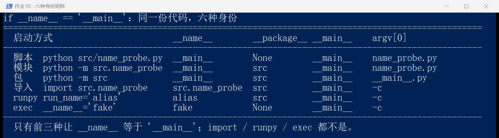
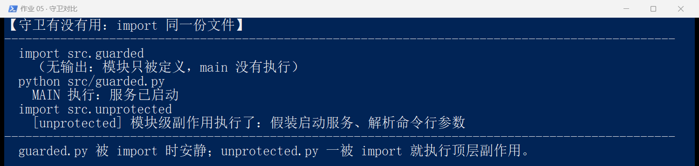
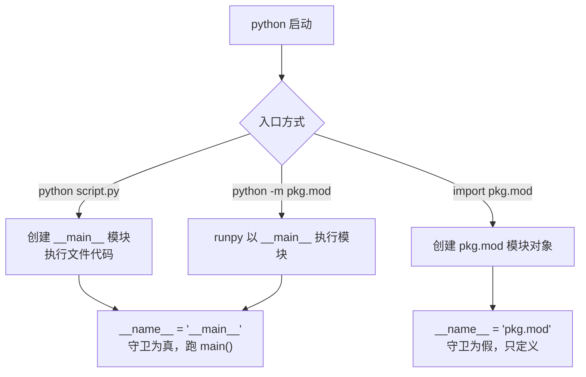
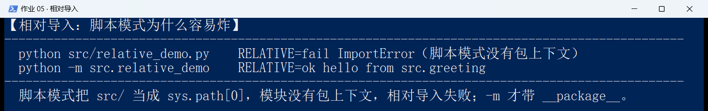
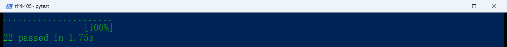

# `if __name__ == '__main__':` 到底在判断什么，为什么要有它

> 作业来源：课堂 PPT「homework · if \_\_name\_\_ == '\_\_main\_\_': 的含义，why?」。
> 结果：用 6 种真实启动方式测出 `__name__` 的取值矩阵；用 guarded / unprotected 两个模块对比 import 副作用；顺带验证相对导入；22 条 pytest 全绿，截图均来自本机真实运行。

仓库：<https://github.com/Hanna2126/homework>



## 1. 先说结论

这行代码只做一件事：**判断当前这个模块，是不是被 Python 当作“程序入口”在执行**。

- `__name__` 是每个模块自带的字符串；
- 当文件被 `python xxx.py` 或 `python -m xxx` 直接执行时，它的值是 `"__main__"`；
- 当文件被 `import` 时，它的值是模块名（如 `src.guarded`）。

`if` 为真，就执行下面的 `main()`；为假，就只提供函数和类，不在 import 时产生副作用。它解决的是“**同一份文件，既要能被导入，又要能单独运行**”这个矛盾。



## 2. 两个名字：`__name__` 与 `__main__`

Python 的每个模块对象都有 `__name__`。它不是用户手写的变量，而是导入系统在创建模块时放进模块全局命名空间的一个属性：

```python
# src/name_probe.py
def snapshot():
    return {"__name__": __name__, "__package__": __package__}

if __name__ == "__main__":
    print(snapshot())
```

`__main__` 则是**入口模块的固定名字**。解释器启动时，会创建一个名为 `__main__` 的模块对象，把它登记进 `sys.modules["__main__"]`，然后把入口文件的代码放进这个模块的字典里执行。所以：

```python
import sys
print(sys.modules["__main__"].__name__)   # 永远是 '__main__'
```

这里有个容易混淆的点：`sys.modules["__main__"]` 是“入口模块对象”，而 `__name__` 是“当前模块自己的名字”。两者在入口文件里相等，在普通被导入的模块里不相等。



## 3. 六种启动方式，六个身份

光讲理论不够，我写了一个只打印身份信息的 `name_probe.py`，用六种方式各跑一遍。

| 启动方式 | `__name__` | `__package__` | `sys.modules['__main__']` |
| --- | --- | --- | --- |
| `python src/name_probe.py` | `__main__` | `None` | `__main__` |
| `python -m src.name_probe` | `__main__` | `src` | `__main__` |
| `python -m src` | `__main__` | `src` | `__main__` |
| `import src.name_probe` | `src.name_probe` | `src` | `__main__` |
| `runpy.run_module(..., run_name='alias')` | `alias` | `src` | `__main__` |
| `exec(..., {'__name__': 'fake'})` | `fake` | `None` | `__main__` |

三个观察：

1. **只有前三种让守卫为真**。脚本、`-m 模块`、`-m 包`，都是“被当作入口执行”，所以 `__name__` 都是 `"__main__"`。
2. **`-m` 会设置 `__package__`，脚本模式不会**。这就是为什么包内相对导入 `from .greeting import hello` 在 `python src/relative_demo.py` 下会失败，在 `python -m src.relative_demo` 下却正常——脚本模式把 `src/` 当成 `sys.path[0]`，文件只是一个孤立模块，没有包上下文。
3. **`__name__` 只是一个普通字符串**。`runpy` 可以传 `run_name='alias'`，`exec` 可以直接塞 `'fake'`，守卫立刻为假。所谓“魔法”只存在于解释器默认给你的那个值。



## 4. 为什么需要它：import 会真的执行你的代码

Python 的 import 不是“把文件读进来看看”，而是**在独立命名空间里从头到尾执行一遍模块体**。函数定义、类定义、常量、`print`、`argparse`、启动服务器，统统会执行。

`src/unprotected.py` 是反面教材：

```python
print("[unprotected] 模块级副作用执行了：假装启动服务、解析命令行参数")

def serve():
    return "服务已启动"

serve()   # 没有守卫，import 时就会跑
```

`src/guarded.py` 则把动作收进 `main()`：

```python
def serve():
    return "服务已启动"

def main():
    print(f"MAIN 执行：{serve()}")

if __name__ == "__main__":
    main()
```

实测结果：

- `import src.guarded`：无输出，只拿到函数；
- `python src/guarded.py`：输出 `MAIN 执行：服务已启动`；
- `import src.unprotected`：立刻打印副作用行。

如果没有守卫，会出四类事故：

1. **服务被启动两次**：入口脚本 import 了一个“自带启动逻辑”的模块，第二次启动直接端口冲突；
2. **测试收集时执行副作用**：pytest 会 import 测试模块；如果测试文件顶层写 `argparse.parse_args()`，pytest 自己的命令行参数会被当成业务参数，轻则报错，重则 `SystemExit` 把收集过程打断；
3. **库不能复用**：别人只想 `from xxx import serve`，结果一导入就启动服务；
4. **多进程重复执行入口**：Windows / macOS 默认 `spawn`，子进程会重新 import 主模块（名字是 `__mp_main__`），守卫为假，正好避免把 CLI 再跑一遍。Linux 的 `fork` 不重新 import，所以这个差异在跨平台时更容易踩。

一句话：**守卫把“定义”和“执行”分开**。模块被 import 时只负责定义，被当入口时才执行动作。

## 5. 它不做什么

这行代码经常被神化，但它只做一次字符串比较，边界很清楚：

- **挡不住模块顶层的代码**。守卫上面的 `print`、读文件、连数据库、解析参数，import 时照样执行。正确做法是连常量初始化都尽量保持无副作用，或者延迟到函数里。
- **不阻止别人 import 后手动调用 `main()`**。`import src.guarded; src.guarded.main()` 完全合法——守卫只是不自动跑。
- **不是“只能运行不能导入”**。它恰恰是为了让同一份文件既能导入又能运行。
- **`__name__` 可以被改写**。`runpy`、`exec`、某些测试框架都能换掉它，所以守卫不是安全边界，只是约定。
- **IDE 的“运行”按钮通常设 `__name__ = '__main__'`**，所以在 IDE 里能跑，在另一个模块里 import 时行为不同，这是正常的。

## 6. 什么时候不需要，什么时候用更好的结构

- **纯库模块**：只提供函数/类，不需要守卫，import 本来就不该有副作用。
- **单文件脚本**：用守卫最直接。
- **包入口**：`python -m pkg` 会执行 `pkg/__main__.py`，这个文件天然就是入口，里面通常也写 `if __name__ == "__main__":` 只是习惯与一致性；更工程化的做法是把逻辑放 `cli.py`，`__main__.py` 只做一行转发：

```python
# src/__main__.py
from .cli import main

if __name__ == "__main__":
    main()
```

- **安装成命令行工具**：在 `pyproject.toml` 里配 `[project.scripts]`，由入口点调用 `main()`，用户得到 `mycmd` 命令，不依赖 `python xxx.py`。

三种方式本质上都在回答同一个问题：**“谁是入口，谁只提供能力”**。

## 7. 代码骨架

`src/name_probe.py`：

```python
import os, sys

def snapshot():
    main = sys.modules.get("__main__")
    return {
        "__name__": __name__,
        "__package__": __package__,
        "__main__": getattr(main, "__name__", None),
        "argv0": os.path.basename(sys.argv[0]) if sys.argv else "",
    }

def report():
    s = snapshot()
    print(f"NAME={s['__name__']} PACKAGE={s['__package__']} MAIN={s['__main__']} ARGV0={s['argv0']}")

if __name__ == "__main__":
    report()
```

它本身也遵守守卫：import 时安静，直接运行时才打印。

`demo.py` 用 `subprocess` 把六种启动方式各跑一次，从输出里解析 `NAME=...` 行，拼成矩阵。这样做的好处是**测的是真实解释器行为，不是我脑子里的假设**。

## 8. 测试：22 条



全部用子进程验证，覆盖：

- **六种身份**：脚本 / `-m 模块` / `-m 包` / import / runpy alias / exec fake 的 `__name__` 与 `__package__`；
- **守卫**：guarded 被 import 时无输出、直接运行有输出、import 后 `main` 仍可调用；unprotected 被 import 时立即产生副作用；
- **相对导入**：脚本模式失败、`-m` 模式成功；
- **结构**：`src/__main__.py` 存在、`__name__` 是 `str`、`src.__name__ == "src"`；
- **反例**：unprotected 的源码中确实没有守卫（只看非注释代码行，避免把注释里的说明误判成守卫）。

“看源码里有没有守卫”这条测试还写错过一次：第一版直接 `assert "__name__" not in src`，结果文件里的注释写了一行“等价于没有 if \_\_name\_\_ 守卫”，测试失败。后来改成剔除注释行再判断——**测试断言的范围要精确到“代码”，不能连注释一起算**。

## 9. 踩过的坑

### 9.1 矩阵解析把键名当成了 `__name__`

第一版 `parse_name_line` 返回的字典键是 `NAME / PACKAGE / MAIN / ARGV0`，但我用 `info.get("__name__")` 取值，六行全是 `?`。改成显式映射后才对。

### 9.2 runpy 和 exec 默认不触发守卫

给 `runpy.run_module(..., run_name='alias')` 和 `exec(..., {'__name__': 'fake'})` 传了非 `__main__` 的名字，守卫为假，自然没有输出。一开始以为命令写错了，后来在命令末尾补了 `g['report']()` / `ns['report']()` 才拿到身份行——这反而成了最直观的证据：**守卫只认字符串**。

### 9.3 脚本模式的 `__package__` 是 `None`，不是空串

直觉会写成 `__package__ == ""`，实测是 `None`。表格里如实写 `None`，测试也按 `None` 断言。

### 9.4 Windows 子进程输出乱码

`subprocess` 默认按系统编码（cp936）解码 UTF-8 输出，中文全变问号。统一设置 `PYTHONIOENCODING=utf-8` 并在 `subprocess.run(..., encoding="utf-8")` 里显式解码后解决。

### 9.5 控制台表格换行、标题被卷走

矩阵一开始 96 个字符宽，在 102 列的控制台里被折成两行，`argv[0]` 直接断在 `name_pro`。另外缓冲区比窗口高时，控制台会滚到底部，标题行被顶掉。把窗口加到 1500×858、缓冲区略大于输出、并缩短相对导入的错误信息后，截图才完整。

## 10. 复杂度与语义

- 守卫本身：一次字符串比较，$O(1)$，开销可以忽略；
- import 的成本：与模块顶层代码成正比，守卫不会减少定义的成本，只避免“执行入口动作”；
- 语义成本：多了一个全局名字 `__name__`，以及一个约定——**入口动作写进 `main()`，顶层只做定义**。

这也是它值得单独讲一节课的原因：它不复杂，但它是“模块”和“程序”两种身份的分界线。

## 11. 复现

```bash
git clone https://github.com/Hanna2126/homework.git
cd homework/05-模块入口与main

python demo.py matrix      # 六种启动方式的身份矩阵
python demo.py import      # 守卫 / 无守卫的 import 对比
python demo.py relative    # 脚本 vs -m 的相对导入
python demo.py all
python -m pytest -q        # 22 passed
```

## 12. 小结

1. **`__name__` 是模块的名字，`__main__` 是入口模块的名字**；只有被当作入口执行时，两者才相等。
2. **守卫的本质是分离“定义”与“执行”**：import 时只提供能力，直接运行时才执行入口动作，避免服务重复启动、测试收集触发副作用、多进程重复跑入口。
3. **它只是字符串比较，不是安全机制**：runpy / exec 可以换名，顶层代码也照样在 import 时执行；真正要守的是“顶层不放副作用”。
4. **`python -m` 比 `python 文件.py` 多了包上下文**：`__package__` 被设置，相对导入才成立；这也是工程里更推荐 `-m` 的原因之一。
